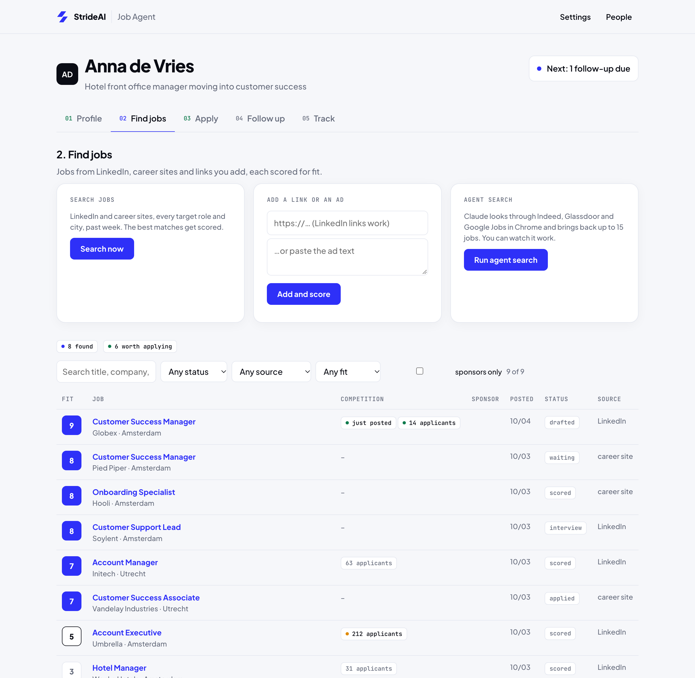
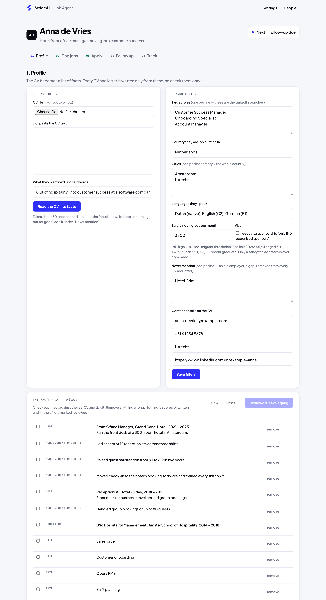
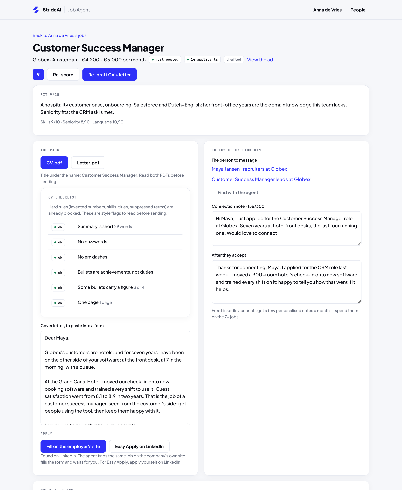
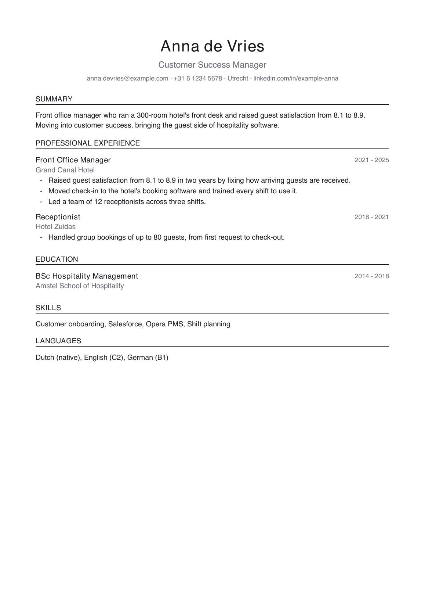
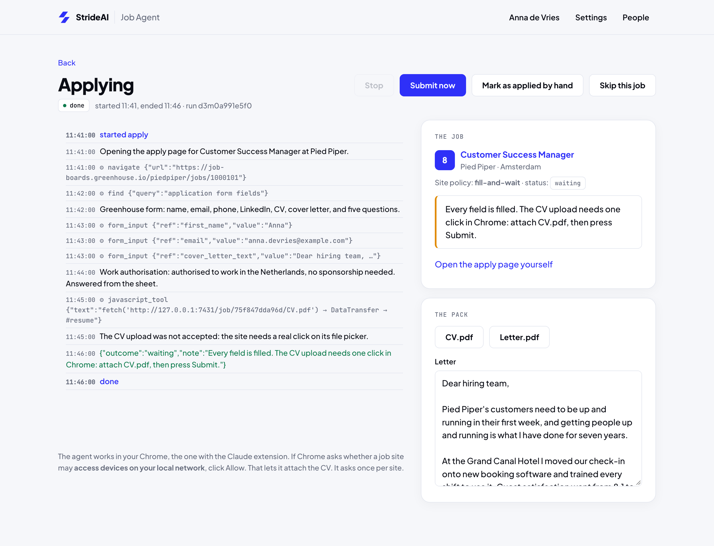
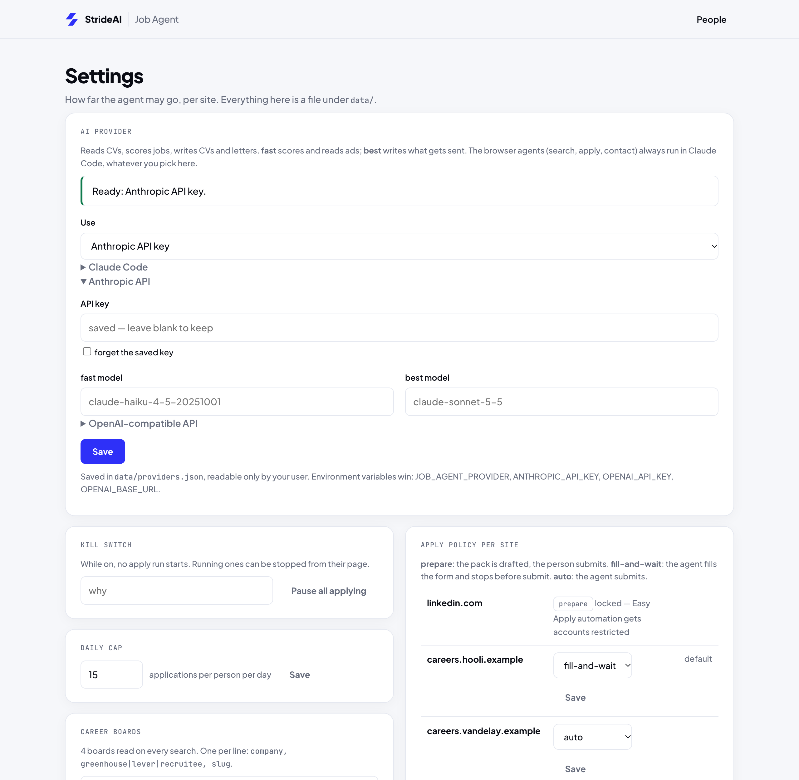

<p align="center"></p>

<h1 align="center">Stride Job Agent</h1>
<p align="center"><b>by StrideAI</b></p>

Paste in your CV once. It finds jobs that fit, scores each one, writes a CV and
cover letter for the good ones using only things that are really on your CV, and
can fill in the application form for you. It always stops before Submit.

It runs on your own computer, with your own AI: a Claude Code subscription, an
Anthropic API key, or any OpenAI-compatible API (OpenAI, OpenRouter, Ollama,
LM Studio). Your CV, your jobs and your keys stay in one folder, `data/`, on your
machine.



## How it works, in five steps

| step | what happens |
|---|---|
| **1 Profile** | Upload your CV (PDF, Word or text). The AI turns it into a list of **facts**: each job, each result, each skill. You tick every fact against your real CV and remove anything wrong. Every CV and letter is written only from these facts. |
| **2 Find jobs** | It searches LinkedIn's public job pages and the career sites you list, for every target role in every city. It also takes a link or pasted ad, and can run a browser agent over Indeed, Glassdoor and Google Jobs. Each job is scored 1–10 for fit, and the scoring explains itself. |
| **3 Apply** | For a job you like it drafts a CV and cover letter (two PDFs) plus two LinkedIn messages. A checker blocks any number, skill, job title or "never mention" term that isn't in your facts. You read both PDFs. Then the agent can fill in the employer's form and stop before Submit. |
| **4 Follow up** | After you mark a job as applied, it reminds you 5 and 10 working days later with who to message and what to say. |
| **5 Track** | Every job by stage, from found to offer. |







### The agent fills in the form, then waits for you

The browser agent works in your own Chrome, through
[Claude Code](https://claude.com/claude-code) and its Claude in Chrome extension.
You can watch every step it takes, live:



### Safety rails

These are on by default, and some can't be switched off:

- **The agent stops before Submit.** The default mode for every site is
  *fill-and-wait*: the form is filled, and you press Submit. *auto* (the agent
  submits) exists, but only for a site you switch on by hand in Settings.
- **LinkedIn is read-only, always.** Automating LinkedIn Easy Apply gets
  accounts restricted, so it is locked to *prepare*: the agent never submits on
  LinkedIn. For a LinkedIn ad it finds the same job on the employer's own site
  and fills the form there.
- **No invented facts.** Tailoring may reorder and reword your facts, never add
  one. Numbers, skills, job titles and suppressed terms are checked
  mechanically before a pack is saved.
- **A daily cap** (15 per person by default), **one application per company**,
  and a **kill switch** in Settings that stops all applying.

## Install

You need [Node.js](https://nodejs.org) 23.6 or newer (it runs the TypeScript
directly, with no build step) and `pdftotext` for PDF CVs
(`brew install poppler` on a Mac, `apt install poppler-utils` on Linux).

```sh
git clone https://github.com/Starfish124/stride-job-agent.git
cd stride-job-agent
npm install           # one dependency: pdf-lib, for the PDFs
npm start             # open http://127.0.0.1:7420
```

Then:

1. **Settings → AI provider**: pick how it should think (below).
2. **People → Add a person**: that's you. Upload your CV, check every fact,
   fill in the search filters (target roles, **country**, cities) and press
   *Mark reviewed*.
3. **Find jobs → Search now.**

### Connect your AI

| provider | what you need | fast model (scoring) | best model (CV, letter) |
|---|---|---|---|
| **Claude Code** | `claude` installed and logged in; uses your subscription, no key | `haiku` | `sonnet` |
| **Anthropic API** | an API key from console.anthropic.com | `claude-haiku-4-5-20251001` | `claude-sonnet-5-5` |
| **OpenAI-compatible** | a key and/or a base URL | you choose | you choose |

All three are set on the Settings page, and every model name can be changed
there. The key is saved in `data/providers.json`, readable only by your user,
and the page never shows it again. Environment variables win over the page:
`JOB_AGENT_PROVIDER` (`claude-cli`, `anthropic` or `openai`), `ANTHROPIC_API_KEY`,
`OPENAI_API_KEY`, `OPENAI_BASE_URL`.

A model running on your own machine with [Ollama](https://ollama.com):

```sh
ollama pull llama3.1
JOB_AGENT_PROVIDER=openai OPENAI_BASE_URL=http://127.0.0.1:11434/v1 npm start
# then set the model name (llama3.1) under OpenAI-compatible in Settings
```

**The browser agents** (agent search, apply, find a contact) need Claude Code
with the Claude in Chrome extension, whichever provider you pick for the text.
Without it, everything else still works. You apply by hand from the drafted
pack, and the agent buttons don't show.



### Where it looks for jobs

- **LinkedIn's public job search**: the pages LinkedIn shows when you are logged
  out. No account, no cookies, a pause between requests, and the search stops
  at the first request LinkedIn refuses.
- **Career sites with an open job feed**: Greenhouse, Lever and Recruitee. In
  Settings → Career boards, add a line per company, e.g.
  `Acme, greenhouse, acme` (the slug is the company's name in its jobs URL).
- **Any link or pasted ad.**
- **Agent search**: Claude in Chrome browses Indeed, Glassdoor and Google Jobs
  for you.

### Needs a visa?

Tick *needs visa sponsorship* on the profile. The apply agent then answers the
work-permit question honestly, and any ad that rules out sponsorship is dropped.

In the Netherlands it goes one step further: only employers on the Dutch
government's (IND) list of recognised sponsors survive. Download that list
once, then weekly:

```sh
npm run jobs -- sponsors
```

## Good to know

- **Keep it on your own machine.** There is no login. The server listens on
  `127.0.0.1` only, and it refuses requests from other websites and from
  unknown host names. To reach it from another device (for example over
  Tailscale), set `PUBLIC_URL` to the address you use. Never expose it to the
  internet: `data/` holds your CV and your API keys.
- **Attaching the CV.** The agent fetches `CV.pdf` from this server and attaches
  it inside the employer's page. The first time on each job site, Chrome asks
  whether that site may *access devices on your local network*. Click Allow.
  Some application systems still insist on a real click on their file picker,
  so the agent leaves the job *waiting* with a note saying what's left.
- **You are responsible for what is sent.** Read the CV and letter before any
  application goes out, and switch a site to *auto* only once it has gone right
  a few times.
- Several people can share one install (a career coach, a household): each
  person has their own profile, jobs and daily cap.

## The terminal view (optional)

`tui/` is a live, read-only view of every agent run, built in Rust. With the
server running:

```sh
cd tui && cargo run --release            # another server: cargo run --release -- http://<host>:7420
```

## Command line

```sh
npm run jobs -- discover <person>   # LinkedIn + career boards for one person
npm run jobs -- score <person>      # free triage, then score the best 25 new jobs
npm run jobs -- tailor <jobId>      # CV + letter + LinkedIn messages for one job
npm run jobs -- due                 # follow-ups due today
npm run jobs -- sponsors            # refresh the Dutch sponsor register
```

Scoring takes the 25 most promising new jobs per run (`maxScorePerRun` in
`data/config.json`). Run it again to work through a big batch.

## How it is built

[docs/how-it-works.md](docs/how-it-works.md) walks through the pieces and why
they are shaped the way they are. The writing rules the CV follows are in
[docs/cv-rules.md](docs/cv-rules.md).

## Development

```sh
npm test                       # 79 checks, node:test, no model or network calls
node demo/shoot.ts             # regenerate the screenshots from a made-up person
node scripts/eval-cv.ts        # score every drafted CV against the CV rules, before and after a prompt change
```

The screenshots come from `demo/shoot.ts`. It builds a made-up person with
made-up jobs in a temp folder and runs the real server on top. No real CVs
appear in this repo.

## License and trademarks

The code is MIT licensed: see [LICENSE](LICENSE). The license covers the code
only. "Stride", "StrideAI" and the Stride mark are trademarks and are not
licensed for use: a fork or product built on this code should use its own name
and logo.
