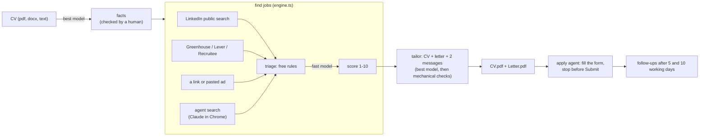

# How the job agent works

This is the walkthrough for anyone who wants to understand the code or build
something like it. It follows one person from CV to follow-up, then covers the
pieces around that loop. Each section names the file to read next.

## The shape

Everything lives in JSON files under `data/` (`lib/store.ts`, atomic writes,
mode 0600). There is no database and no framework: one `node:http` server
(`server.ts`) renders HTML strings (`web/*.ts`), and one npm dependency
(`pdf-lib`) draws the PDFs.

Five decisions carry the design:

1. **Facts, not a CV.** The CV is read once into a list of small facts (a role,
   an achievement under it, a skill, a language), and a person checks every
   one. Everything written afterwards may only reorder and reword those facts.
   That's what makes it safe to let a model write a CV with someone's name on
   it.
2. **Free before paid.** Most jobs are dropped by plain rules before any model
   sees them (wrong language, salary under the floor, no sponsorship), and only
   the best 25 survivors per run are scored. A model call costs money and
   time; a regular expression doesn't.
3. **Check the model's work with code.** A tailored pack is rejected when it
   contains a number, skill or job title that isn't in the facts or the ad. It
   gets one retry with the problem spelled out, then fails loudly.
4. **A person presses Submit.** The browser agent fills forms and stops.
   Submitting is a per-site opt-in, and LinkedIn is locked out of it entirely.
5. **Your machine, your model.** Text calls go to whichever provider you pick;
   the browser runs in your own Chrome. Nothing is sent anywhere else.

## 1 · Profile: the CV becomes facts (`lib/profile.ts`, `lib/cvtext.ts`)

`cvText` reads a `.docx` with `unzip` and a PDF with `pdftotext`. The intake
prompt (`buildIntakePrompt`) asks the **best** model for JSON: contact details,
a headline, target roles, languages, and the facts. The instruction is "copy,
never embellish": a vague CV gives vague facts.

`validatePerson` lists what is still missing (an email, target roles, a
country, at least one role, a title and employer on every role) and the flag
that matters most: `reviewed`. Nothing is scored or written until a person has
read every fact against the real CV and set it.

Two more tools here:

- **Never mention** (`suppress`) is a list of terms, such as an old employer or
  a gap, that must not appear in anything generated. `visibleFacts` drops
  matching facts at the source, so no prompt ever sees them, and
  `leaksSuppressed` checks every output again.
- **Questions to ask them** (`buildQuestionsPrompt`): a CV with few numbers
  makes a weak tailored CV, and the writer may not invent any. So the model
  writes five questions to ask the person out loud, and the typed answers
  become new facts.

## 2 · Find jobs (`lib/engine.ts`, `lib/sources/`, `lib/triage.ts`)

`discover` runs four sources into one list, deduplicated by `jobId`: 12 hex
characters of a hash over the normalised URL, with tracking parameters, the
trailing slash and LinkedIn's per-country subdomains removed.

- **LinkedIn** (`sources/linkedin.ts`): the logged-out "see more jobs"
  endpoint, one search per target role × city, a few pages each, with a pause
  between requests. A bare city gets the person's country added; the endpoint
  answers "Amsterdam" with nothing and "Amsterdam, Netherlands" in full. The
  detail page for a job is fetched only after its search card survives triage.
- **Career boards** (`sources/boards.ts`): Greenhouse, Lever and Recruitee
  publish a company's whole job list as JSON, descriptions included, so a
  board job never needs a second request. A board is global, so a job is kept
  only when its title names a target role and its location names one of the
  person's cities, their country, "remote" or "hybrid", or nothing at all.
- **A link or a pasted ad** (`extract.ts`) goes through cheap readers first:
  schema.org `JobPosting` JSON-LD, then LinkedIn's markup, then common
  description containers. Only a page none of them can read goes to the
  **fast** model.
- **Agent search** (`agents/search.ts`): Claude in Chrome browses Indeed,
  Glassdoor and Google Jobs, which block plain requests, and saves what it
  finds to `found.json` as it goes, so a run cut short still keeps its jobs.

**Triage** (`triage.ts`) is free and deterministic. It drops a job for a
stated reason that is shown on the board, so a wrong drop can be argued with:

- the ad rules out visa sponsorship, for someone who needs it;
- the ad is in Dutch or requires Dutch, for someone who doesn't speak it ("Dutch
  (basic)" on a CV doesn't count);
- a **stated** salary is under the person's floor. A salary the ad doesn't
  state never drops a job: dropping a good job is invisible and permanent,
  while keeping a bad one costs one model call;
- in the Netherlands, for someone who needs a visa: the employer isn't on the
  government (IND) register of recognised sponsors (`sponsors.ts`, matched on
  a normalised company name).

The survivors are ranked by how often the target roles appear (a whole phrase
in the title counts most) and the top 25 are **scored** (`score.ts`): 1–10 with
written reasoning, plus sub-scores for skills, seniority and language. The
board sorts by fit, then by competition (fewer applicants first), then by date.

## 3 · Apply: the pack (`lib/tailor.ts`, `lib/cvcheck.ts`, `lib/pdf.ts`)

`buildTailorPrompt` sends the job and the visible facts (each with its id) to
the **best** model and asks for a pack: a target title, a 2–3 line summary,
bullets that each cite a fact id, skills, a cover letter, a LinkedIn
connection note (300 characters at most) and a follow-up message.

`checkPack` then checks it with code:

- every bullet cites a real, visible achievement or role;
- every skill is one of the person's skills, languages or certificates;
- every word of the title under the name comes from a title they held or the
  job's own title, so a "Coordinator" is never printed as "Manager" (`checkTitle`);
- every number anywhere in the pack appears in the facts, the person's
  details or the ad;
- no suppressed term appears.

A failed check gets one regeneration with the problem spelled out. If that
fails too, the job shows the error. `cvcheck.ts` adds softer style checks
(summary length, buzzwords, em dashes, bullets that describe duties instead of
results, page count), shown as a checklist to read before sending.
[cv-rules.md](cv-rules.md) is the full rule set.

`pdf.ts` draws the CV and letter with pdf-lib's built-in Helvetica. Job titles,
employers and dates are printed from the facts, never from the model, so the
model can't retitle a job someone held. The standard PDF fonts only cover
Western European characters, so a character they can't draw is replaced
instead of crashing the render.

## 4 · Apply: the agent (`lib/agent.ts`, `lib/agents/`, `lib/policy.ts`)

Every browser task is one `claude -p --chrome` process
(`agent.ts:startRun`) with `--output-format stream-json`. Each line it prints
becomes an event: text, a tool call, the result. Events are kept in memory for
the live page, appended to `data/agent-runs/<id>.jsonl` as evidence, and
streamed to the browser over server-sent events. Two flags matter:

- `--allowedTools mcp__claude-in-chrome__*`: `-p` can't answer a permission
  prompt, so without the allow-list every browser call is refused.
- `--disallowedTools Agent`: no sub-agents. The stock browser sub-agent never
  commits an action, so an `auto` apply handed to it would never press Submit.

The apply prompt (`agents/apply.ts`) carries a **candidate sheet** built only
from the reviewed facts (name, contact details, work authorisation, salary
expectation, languages, the letter) and the rule: never invent an answer;
leave the field and report it. The run ends with one JSON line: `submitted`,
`waiting` (filled, with a note on what's left), `blocked` or `failed`.

**Files.** The agent can't drive a native file picker, so it fetches
`CV.pdf` from this server inside the employer's page and attaches it with a
`DataTransfer`. The PDF routes allow cross-origin reads only while that job's
apply run is live. Chrome asks once per site whether it may reach the local
network, and some applicant systems ignore a programmatic attach; both end as
`waiting`, with a note that says so.

**Policy** (`policy.ts`), checked by `canApply` before any run starts:

- a mode per host: `prepare` (you submit), `fill-and-wait` (the default), or
  `auto`; a parent domain covers its subdomains;
- `linkedin.com` is locked to `prepare`. A LinkedIn ad is applied to on the
  employer's own site, found by the agent, always fill-and-wait;
- a daily cap per person, one application per company (normalised name), and
  a stop switch.

## 5 · Follow up (`lib/followup.ts`, `agents/contact.ts`)

"I applied" sets two nudge dates, 5 and 10 working days later. The follow-up
page shows the due ones with the connection note and message from the pack,
LinkedIn people-search links for the named contact, recruiters and the team
lead, and optionally the contact agent, which looks (and only looks) for up to
three people on LinkedIn in your logged-in browser.

## Around the loop

- **Providers** (`lib/llm.ts`): every text call is `fastLlm` or `bestLlm`, a
  plain `(prompt) => Promise<string>`. `complete()` sends it to the Claude Code
  CLI (`claude -p`, run from the temp dir so no project instructions leak in),
  the Anthropic Messages API, or `{base}/chat/completions` on any
  OpenAI-compatible server. Plain `fetch`, no SDK. Because the type is one
  function, every test injects a fake model.
- **The request guard** (`lib/guard.ts`): there is no login, so the browser
  is the threat. Any site you visit could post a form to `127.0.0.1`, or reach
  the server through a DNS name it points there. Without the guard, that could
  turn on `auto` or point the AI provider at a server that receives every CV.
  Only loopback host names (plus `PUBLIC_URL`'s host) and same-origin posts
  get through.
- **The terminal view** (`tui/`, Rust with `ratatui` and `rataflow`) reads
  `/api/stream`: every agent event plus per-person counts, read-only.

## Build your own: the order that works

1. The person record and `validatePerson`. Decide what a fact is before
   anything reads a CV.
2. Intake from pasted text, then the review screen. Read real output against
   real CVs; this is where the "copy, never embellish" rules come from.
3. One job, pasted by hand, scored. Then the pack and `checkPack`; write the
   check before you trust the prompt.
4. The PDFs. Rendering facts yourself is less code than validating a
   model-written layout.
5. Discovery and triage. Only once scoring works is it worth finding 200 jobs.
6. The browser agent last, in fill-and-wait. It is the slowest and the least
   predictable part, and everything before it is useful without it.

## Gotchas, in one place

| symptom | cause | fix |
|---|---|---|
| every browser call: "Claude in Chrome requires permission" | `claude -p` can't answer a prompt | `--allowedTools mcp__claude-in-chrome__*` |
| `auto` apply never presses Submit | the run handed the task to a sub-agent | `--disallowedTools Agent` |
| LinkedIn search returns nothing | a bare city name | add the country: "Berlin, Germany" |
| "could not be parsed" after an SSH session | the CLI answered "Not logged in" as its *result* | `extractCliResult` throws on the error envelope |
| a model answer with a note after the JSON breaks parsing | last-`}` parsing | first `}` that closes a valid object (`parseJsonObject`) |
| PDF upload works by hand, fails under a service manager | `pdftotext` not on the service's `PATH` | check `PATH` in the service's own environment |
| the CV attach hangs on a new job site | Chrome's local-network permission prompt | click Allow once per site; the run ends as `waiting` |
| a render crashes on "Łukasz" | the standard PDF fonts cover WinAnsi only | replace characters the font can't draw |
